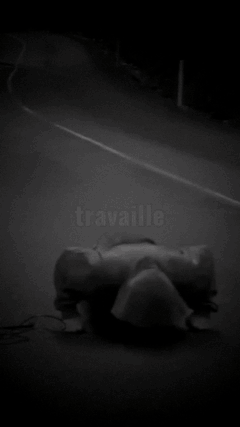
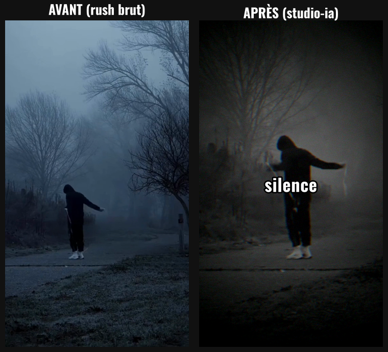
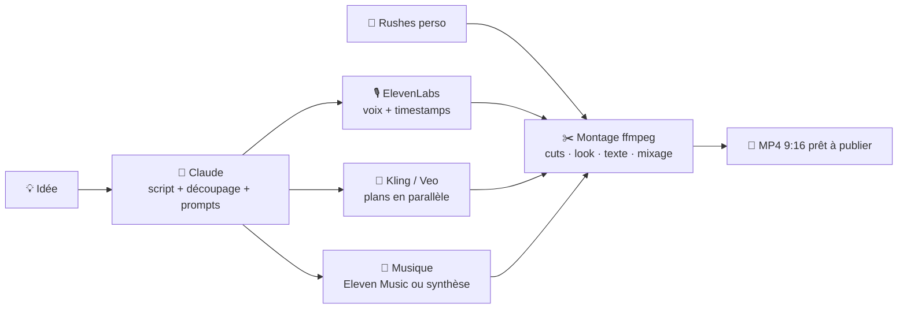

# 🎬 studio-ia

**Pipeline de production automatique de vidéos courtes verticales (TikTok, Reels, Shorts), qui orchestre plusieurs IA spécialisées.**

On lui donne une idée (ou ses propres images brutes), et il livre un `.mp4` prêt à publier : script, voix off, plans vidéo, musique, montage rythmé, étalonnage et texte synchronisé mot par mot.

<p align="center">
  
  &nbsp;&nbsp;
  
</p>

> 👉 **Pour comprendre le projet sans lire le code :** [docs/EXPLICATION.md](docs/EXPLICATION.md)

---

## ✨ Ce que fait l'outil

| | |
|---|---|
| 🧠 **Direction artistique** | Claude écrit le texte de la voix off, découpe la vidéo en plans et rédige les prompts de chaque IA (sortie JSON validée par schéma). |
| 🎙️ **Voix off** | ElevenLabs génère la voix **avec l'horodatage de chaque mot**. |
| 🎥 **Plans vidéo** | Kling 3.0 ou Veo 3.1 (via fal.ai) génèrent tous les plans **en parallèle**, en 9:16, avec un personnage cohérent d'un plan à l'autre. |
| 🎞️ **Mode rushes** | Ou bien : l'outil monte **tes propres images**. Il détecte les scènes, coupe sur le rythme de la voix et applique des ralentis fluides. Coût de génération : 0 €. |
| 🎵 **Musique** | Eleven Music, **ou** un moteur de synthèse local (gratuit, libre de droits) qui place un impact sonore au début de chaque phrase. |
| ✂️ **Montage** | Recadrage 9:16, étalonnage (look N&B VHS, sombre…), effet « punch + flash » à chaque cut, texte mot par mot, musique qui s'efface sous la voix (*ducking*), volume normalisé à -14 LUFS. |
| 🔒 **Sécurité & coûts** | Aucune clé dans le code, masquage des secrets, plafond de budget, validation avant dépense, cache anti-double-facturation. |

## 🏗️ Architecture



Chaque étape écrit son résultat dans le dossier du projet (`plan.json`, `voix.mp3`, `plans/`, `musique.mp3`).
**Si une étape échoue, on relance : seules les étapes manquantes sont refaites, et rien n'est repayé.**

## 📁 Structure du code

```
studio_ia/
├── config.py     # clés API (lecture sécurisée), constantes, prix, masquage des secrets
├── direction.py  # étape 1 : Claude → plan JSON (texte, plans, prompts)
├── voix.py       # étape 2 : ElevenLabs → voix + horodatage mot par mot
├── video.py      # étape 3 : Kling/Veo → plans (parallélisme, reprises, estimation de coût)
├── musique.py    # étape 4 : Eleven Music ou synthèse audio locale (numpy)
├── rushes.py     # mode rushes : alignement voix/texte, détection de scènes, plan de coupe
├── montage.py    # étape 5 : ffmpeg (recadrage, look, impacts, sous-titres, mixage)
├── outils.py     # téléchargement sécurisé, appels ffmpeg sans shell
└── cli.py        # interface en ligne de commande
tests/            # 11 tests, aucun appel réseau ni clé API nécessaire
```

## 🚀 Installation

Prérequis : **Python 3.10+** et **ffmpeg** (`brew install ffmpeg` / `winget install Gyan.FFmpeg` / `apt install ffmpeg`).

```bash
git clone https://github.com/<ton-compte>/studio-ia.git
cd studio-ia
pip install -r requirements.txt
cp .env.example .env      # puis colle tes clés dans .env (jamais publié)
```

Pour le texte, installe la police [Oswald](https://fonts.google.com/specimen/Oswald) (ou change `SUB_FONT` dans `.env`).

## ▶️ Utilisation

**Mode IA : une idée, une vidéo**
```bash
python -m studio_ia "Dark motivation : un boxeur seul à l'aube" \
    --voix "homme, grave, posé" --duree 20 --look vhs
```
Le script et le découpage s'affichent avec **l'estimation du coût**. Rien n'est dépensé avant ta validation.

**Mode rushes : tes images + ta voix**
```bash
python -m studio_ia --rushes brut.mov \
    --voix-fichier voix.mp3 \
    --texte "Travaille en silence. Disparais s'il le faut. Et reviens comme quelqu'un qu'ils ne reconnaîtront plus." \
    --exposition 1.7 --style-musique atmo
```

**Options utiles**

| Option | Effet |
|---|---|
| `--plan-seulement` | Écrit juste le script (quasi gratuit) |
| `--modele kling\|veo\|veo-fast` | Choix de l'IA vidéo |
| `--moteur-musique synthese\|eleven\|aucune` | Source de la musique |
| `--look vhs\|sombre\|noir-blanc\|naturel` | Étalonnage |
| `--impact 1.5` | Force de l'effet punch/flash aux cuts |
| `--rythme 0.5` | Durée moyenne d'un plan en mode rushes |
| `--budget-max 5` | Plafond de dépense vidéo ($) |
| `--projet <dossier>` | Reprendre un projet existant |

## 💰 Coûts indicatifs (octobre 2026)

| Poste | Tarif |
|---|---|
| Kling 3.0 Pro (fal.ai, sans audio) | ~0,11 $ / seconde générée |
| ElevenLabs (voix + musique) | dès 6 $/mois (Starter), 22 $/mois avec licence commerciale (Creator) |
| Claude Sonnet 5.5 | ~0,02 $ par vidéo |
| Mode rushes + musique synthétisée | **0 $ de génération** |

Les tarifs évoluent : ils sont centralisés dans `studio_ia/config.py` (`PRIX_PAR_SECONDE`).

## 🔒 Sécurité

Voir [SECURITY.md](SECURITY.md). En bref : clés uniquement dans `.env` (ignoré par Git), masquage automatique dans les messages, scan anti-fuite (gitleaks) en local et dans la CI, plafond de budget, appels système sans shell.

## 🧪 Tests

```bash
pip install -r requirements-dev.txt
pytest
```
Les tests couvrent la sécurité (clés, injection), la logique (alignement, durées, coûts, coupes) et un montage complet de bout en bout avec des médias de synthèse. **Aucune clé API n'est nécessaire.**

## 🗺️ Pistes d'évolution

- **Bibliothèque de clips** : réutiliser des plans déjà générés, choisis par Claude selon le texte, pour diviser le coût vidéo.
- **Agent critique** : générer plusieurs textes et ne garder que le meilleur hook.
- **Contrôle qualité automatique** : Claude regarde des images du rendu final et fait corriger les plans ratés.
- **Suivi du sujet** au recadrage (aujourd'hui centré) et support de Wan 3.0.

## 👤 Auteur

**[David]**, créateur de contenu « dark motivation » sur TikTok.
Conçu et développé avec l'assistance de Claude (Anthropic).

Licence [MIT](LICENSE).
